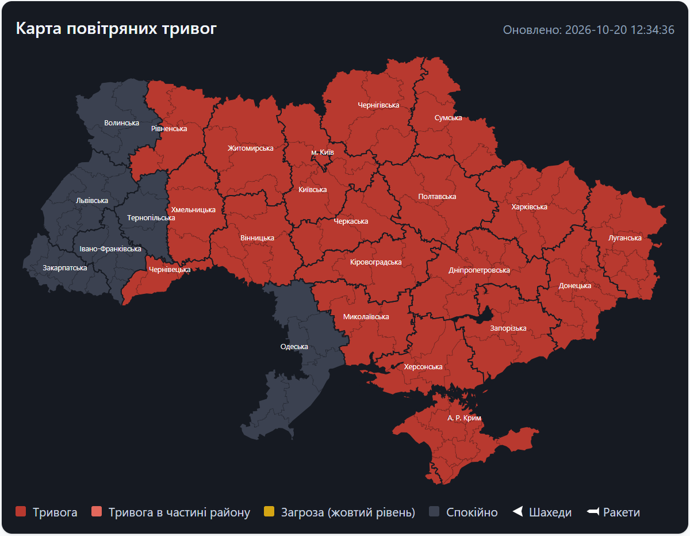
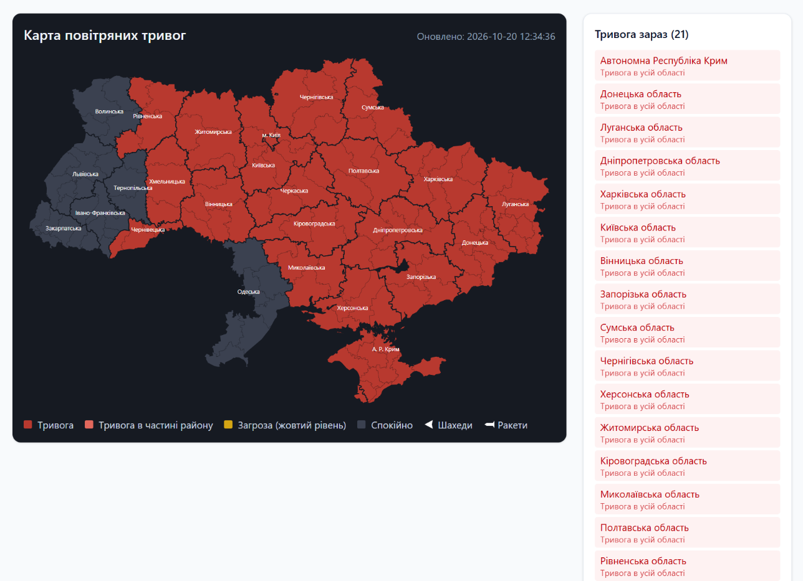

# Карта тривог + AI-харнес



<details>
<summary>Вся страница со списком областей</summary>



</details>

Скриншоты сняты без токена alerts.in.ua (резервный источник ubilling), поэтому на них нет жёлтых зон и шахедов.

Next.js + React + Tailwind. Две страницы:

- **`/` — Карта воздушных тревог по районам.** Красный — тревога, светло-красный — тревога в части района (громаде),
  жёлтый — угроза (жёлтый уровень). Иконки шахедов и ракет — в районах/областях, где объявлена такая угроза.
  Данные обновляются каждые 30 секунд.
  Данные: [alerts.in.ua](https://devs.alerts.in.ua/) (бесплатный токен `ALERTS_IN_UA_TOKEN`).
  Без токена — открытый API [ubilling.net.ua/aerialalerts](https://ubilling.net.ua/aerialalerts/): только «тревога / нет» по областям.
  Границы районов: [ukrainian_geodata](https://github.com/slawomirmatuszak/ukrainian_geodata) (CC BY 4.0).
- **`/ai` — Чат с AI-агентом.** Выбор модели (Claude Opus / Sonnet / Haiku), поиск в интернете, работа с файлами в папке `workspace/`.

## Где что лежит

| Файл | Что делает |
|---|---|
| `lib/agent.ts` | Харнес: инструменты + цикл агента |
| `lib/models.ts` | Список моделей для выбора |
| `app/page.tsx` | Карта тривог |
| `lib/regions.ts` | Области и районы карты, типы данных о тревогах |
| `lib/map-data.json` | SVG-контуры областей и районов (генерируется `node scripts/build-map.mjs`) |
| `app/ai/page.tsx` | Чат |
| `app/api/alerts/route.ts` | Прокси к API тревог (alerts.in.ua или ubilling) |
| `app/api/agent/route.ts` | Запуск агента |

## Что такое харнес

LLM умеет только получить текст и вернуть текст. **Харнес** — код вокруг модели, который делает из неё агента:

1. Отправляем модели историю чата и список инструментов.
2. Модель отвечает: «вызови `read_file` с `{path: "hello.txt"}`».
3. **Наш код** выполняет инструмент и возвращает модели результат.
4. Повторяем, пока модель не ответит без запроса инструмента.

Поиск в интернете (`web_search`) — серверный инструмент: его выполняет сам Anthropic, а не наш код.
Поэтому в `runTool` его нет — мы только добавляем его в список инструментов.

## Запуск

```
copy .env.local.example .env.local   (вставь свой ANTHROPIC_API_KEY и, по желанию, ALERTS_IN_UA_TOKEN)
npm install
npm run dev
```

Открой http://localhost:3000
